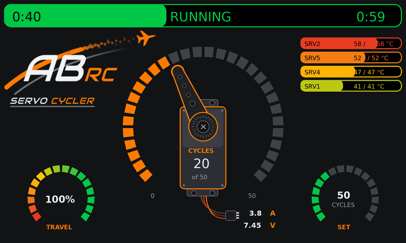

  

# Servo Cycler for FrSky Ethos

A servo tester for FrSky Ethos radios by **ABRC**. It runs your servos end to end for a set
number of cycles, smoothly and at a constant speed, while the dashboard shows progress,
servo temperatures, current and receiver voltage. Weak, worn or overheating servos show up
before they let you down in a model.

  

> **Read [DISCLAIMER.txt](DISCLAIMER.txt) before use.** Servo Cycler is meant to find poor
> servos, and a test can damage or destroy a servo. Use it **only in a separate test model**,
> never in a model that is flown or driven.

---

## Features

- **Smooth, even motion.** The radio itself moves the servos (Slow up / Slow down 0.5 s); the
  script only sets the next end point. Screen refreshes can never make a servo stutter.
- **30 cycles per minute, full travel.** One cycle = centre > one end > other end > centre.
- **1 – 999 cycles**, set with pot 2 (exponential, so small numbers are easy to set).
- **Travel 0 – 100 %**, set with pot 1.
- **Up to 16 channels** at once, each with its own mix.
- **Dashboard:**
  - progress bar: elapsed time | RUNNING | time left
  - big cycle dial with a servo; the arm is the pointer, the count is on the case
  - temperature bars (green to red) for the 4 hottest of up to 8 sensors, with the
    highest temperature of the test
  - current (A) and receiver battery (V)
  - travel and cycles dials
- **Safety built in:** runs only in the model that shows the widget, stops when you change
  model, and never starts at power-up when the start switch is already ON.
- **Scales** to 800×480 (X20 family), 640×360 (X14), 480×320 (X18 / Twin) and
  480×272 (X10 / X12S) screens.

---

## Installation

Download the latest zip from the [Releases](../../releases) page.

**With the FrSky Suite (recommended)**
1. Connect the radio to the computer.
2. In the FrSky Suite open **Lua library → Install from local .zip** and pick
   `ServoCycler-x.y.z-Suite.zip`.

**By hand**
1. Unpack `ServoCycler-x.y.z-SD.zip`.
2. Copy the `svcycler` folder into the `scripts` folder of the radio, so you get
   `scripts/svcycler/main.lua`.

**Model picture (optional)**
Copy `svcycler.png` from the `model-images` folder for your radio into `bitmaps/models/`
(see `model-images/README.txt`).

---

## Setup

Do all of this in a **separate test model** that is used for nothing else.

<!-- SCREENSHOT: Model > Lua with Servo Cycler enabled -->
**1. Enable the Lua source**
Model setup > **Lua** > switch **Servo Cycler** on.

<!-- SCREENSHOT: Free mix with source Servo Cycler -->
**2. Add a mix for each servo channel**
Mixes > add a **Free mix** > source **Servo Cycler** (category Lua), weight 100 %,
output to the channel of the servo. Repeat for every channel you want to test.

<!-- SCREENSHOT: Outputs > channel with Slow up / Slow down 0.5 s -->
**3. Set Slow up and Slow down to 0.5 s**
Either on the output channel (Outputs > channel) **or** in the mix, not both.
This is what makes the motion smooth and gives full travel at 30 cycles per minute.

<!-- SCREENSHOT: screen layout with the Servo Cycler widget -->
**4. Add the widget**
Add a screen with a **full-screen** layout and choose the **Servo Cycler** widget.

<!-- SCREENSHOT: widget Configure pages -->
**5. Configure the widget** (long press on the widget > Configure)

| Setting | What it does |
|---|---|
| Start switch | ON = start, OFF = stop. Use a spare switch that does nothing else. |
| Cycles knob (pot 2) | Number of cycles: 25 % = 17, 50 % = 126, 75 % = 422, full = 999 |
| Cycles (no knob) | Fixed number of cycles when no knob is set |
| Travel knob (pot 1) | Travel 0 – 100 % |
| Travel (no knob) | Fixed travel when no knob is set |
| Bottom dials | Travel left / Cycles right, or swapped |
| Temp sensor 1 – 8 | Servo temperature sensors (telemetry); the 4 hottest are shown |
| Temp warning | Temperature at which a bar is fully red |
| Current sensor | Current sensor (telemetry) |
| RX battery sensor | Receiver voltage sensor (telemetry) |

**6. Check before the first test**
Make sure every servo reaches both end points without hitting a stop. Reduce the channel
limits or the travel knob if needed.

---

## Running a test

<!-- SCREENSHOT: dashboard IDLE / RUNNING / DONE -->
1. Set the number of cycles with pot 2 and the travel with pot 1.
2. Switch the start switch **ON**. The bar turns green and fills up as the test runs.
3. Switch it **OFF** to stop at any time; the servos return to the centre.
4. After **DONE**, switch OFF and ON again to run another test.

If the start switch is already ON when you switch the radio on (or change to the model),
nothing starts until you switch it OFF and ON again.

---

## Safety

The full text is in **[DISCLAIMER.txt](DISCLAIMER.txt)**. In short:

- **Never** add the Servo Cycler mixes or widget to a model that is flown or driven.
- **Never** run a test while a model is being operated, and never on a throttle / ESC channel.
- Remove the propeller or disconnect the motor when testing servos installed in a model.
- Watch the test and stop it if a servo gets hot, buzzes, stalls or draws high current.
- A servo that passes the test can still fail later: it is not proof of airworthiness.

---

## License

Code: [MIT](LICENSE) © 2026 Adam Bednarik (ABRC).
The ABRC name and logos are not covered by the license.

Servo Cycler is an independent project and is not affiliated with FrSky.
